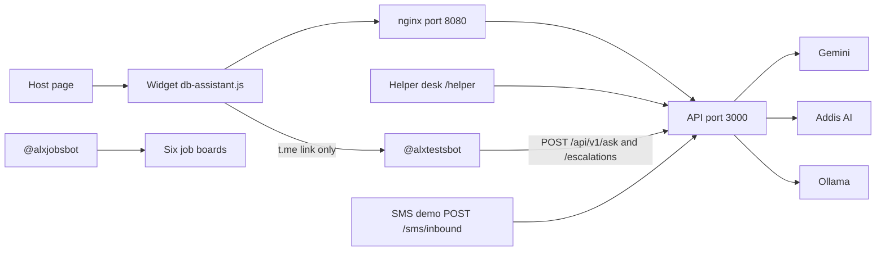

# LangBridge, track 3, Team: Peniel Zewdu, Dagim Tsegaw, Samuel Demilew

**Name:** Savanna Assistant (LangBridge). **Track:** 3, Multilingual assistant and live help.

This repository has three folders. `docker-compose.yml`, `openapi.yaml`, and `CONFORMANCE.md` live in `multilingual-assistant/`, not in this root. A judge should start in that folder for the widget and the API.

| Folder                    | What it is                              | Readme                                                               |
| ------------------------- | --------------------------------------- | -------------------------------------------------------------------- |
| `multilingual-assistant/` | Widget, API, Savanna pages, helper desk | [multilingual-assistant/README.md](multilingual-assistant/README.md) |
| `telegram-support-bot/`   | Course and person bot, @alxtestsbot     | [telegram-support-bot/README.md](telegram-support-bot/README.md)     |
| `telegram-jobs-bot/`      | Job-alert bot, @alxjobsbot              | [telegram-jobs-bot/README.md](telegram-jobs-bot/README.md)           |

## What it does

The widget is one script tag. It searches the lesson on the page, shows the section it used, and can speak the reply.

The API answers from those sections, stores a ticket for a person, and can speak or translate when a key is set.

Two Telegram bots sit beside it. @alxtestsbot answers course questions and can open a ticket. @alxjobsbot scrapes job boards and sends alerts. They do not share one token.

### Three questions the guide asks

**At 23:00, with no helper online.** The widget does not read the clock. It shows the same sentence at every hour: "A tutor will answer. It may take until morning." The ticket is stored as `waiting` in `multilingual-assistant/api/data/escalations.json`. The API does not message a helper. A person sees the queue only by opening `/helper` and sending the helper token. If the phone is offline, the widget shows "Saved on this phone. It will send when you are online." and keeps the ticket in `localStorage` under `db-assistant:outbox`.

**How a judge sees that an answer was not invented.** A hit shows the text and a Sources list. Each source is the section title and its URL. With no model, the text is an excerpt copied from that section (`module/providers/none.js`). The API calls Gemini or Ollama only when a section scores at or above 0.5, and it sends those sections only. The test `ask uses the model only for sections above the threshold` passed on 16 Nov 2026. A miss returns `answer: null` and `mode: "not-found"`. The widget then shows "I could not find this in the course." If the model errors, `mode` is `offline-fallback` and the text is still the excerpt.

**What still works with no paid AI.** Leave `GEMINI_API_KEY` and `ADDIS_API_KEY` empty. Compose defaults `AI_PROVIDER` to `none` when that variable is unset. Keyword search, the source link, the not-found sentence, tickets, the helper desk, the SMS demo, browser speech when the device has a matching voice, the language picker, and the display tools still work. @alxtestsbot can answer from its local FAQ when `BACKEND_API_BASE_URL` is empty or the API call fails. @alxjobsbot can scrape and send listings without Addis. Page translation needs Gemini and stays off. Health then reports `ai`, `ttsAddis`, and `ttsGemini` as false.

### Architecture



The widget does not call the Telegram API. It opens `https://t.me/<username>?start=<lang>_<topic>`. @alxjobsbot does not call this API. Ollama is used only when `AI_PROVIDER=ollama` and both Ollama variables are set. Tests use a fake `fetch`. A live Ollama process was not called.

## The main task we tested

Draft, to be confirmed with the co-designer: on the concept page, ask what is shaping the future of VA work, listen to the answer, and leave a message for a tutor.

A person has not completed that task unaided on their own phone. See [multilingual-assistant/docs/TESTING.md](multilingual-assistant/docs/TESTING.md).

## Run it

Prerequisites: Docker with Compose v2, and Node.js. Tests on this machine used Node v22.5.1 on 16 Nov 2026. The jobs bot needs Node 22.5 or newer because it uses `node:sqlite`. The API image is `node:22-alpine`.

```bash
cd multilingual-assistant
cp .env.example .env
docker compose up --build
```

`docker compose config` exited 0 on this machine. A clean clone on another laptop was not started. Do not treat this machine's existing containers as that check.

Open:

- http://localhost:8080/demo/blank.html
- http://localhost:8080/pages/concept-with-navigation.html
- http://localhost:8080/pages/jobs.html
- http://localhost:8080/docs
- http://localhost:8080/helper
- http://localhost:8080/api/v1/health

The API is also on http://localhost:3000 . Nginx proxies `/api/`, `/sms/`, `/docs`, `/helper`, and `/openapi.yaml` to it.

Empty Gemini and Addis keys are a valid no-AI run. Compose uses `AI_PROVIDER=none` when that variable is missing. Tickets can still be created. Listing and answering them needs `HELPER_TOKEN`. If that variable is empty, `GET /api/v1/escalations` returns 503.

The tracked `.env.example` currently has a nonempty `HELPER_TOKEN`, and it matches the local `.env`. Replace it with your own before you share the repo or the helper desk. This file does not print the value. Git history of `.env.example` contains one nonempty `HELPER_TOKEN` line. Rotate the live token if that value was ever used.

`TELEGRAM_BOT_USERNAME` in `.env` and in `.env.example` is `alxtestsbot`. That is a public bot name, not a secret.

Variables the API reads, and what may stay empty:

| Variable                | Empty is OK?             | Effect                                                                                                 |
| ----------------------- | ------------------------ | ------------------------------------------------------------------------------------------------------ |
| `PORT`                  | Yes                      | Default 3000. Compose sets 3000.                                                                       |
| `AI_PROVIDER`           | Yes                      | Unset or anything other than `gemini` or `ollama` means keyword answers. Compose default is `none`.    |
| `GEMINI_API_KEY`        | Yes                      | Empty keeps Gemini off.                                                                                |
| `GEMINI_MODEL`          | Yes                      | Default `gemini-3.5-flash` when a key is set.                                                          |
| `GEMINI_TTS_MODEL`      | Yes                      | Default `gemini-2.5-flash-preview-tts`.                                                                |
| `TTS_PROVIDER`          | Yes                      | `none` (default), `addis`, or `mock`. `mock` is a silent WAV for Amharic, Oromo, Tigrinya, and Somali. |
| `ADDIS_API_KEY`         | Yes                      | Empty keeps Addis off.                                                                                 |
| `ADDIS_BASE_URL`        | Yes                      | Default `https://api.addisassistant.com`.                                                              |
| `OLLAMA_BASE_URL`       | Yes                      | Needed only with `AI_PROVIDER=ollama`.                                                                 |
| `OLLAMA_MODEL`          | Yes                      | Needed only with `AI_PROVIDER=ollama`.                                                                 |
| `HELPER_TOKEN`          | Yes for creating tickets | Empty makes the helper list and PATCH return 503.                                                      |
| `TELEGRAM_BOT_USERNAME` | Yes                      | Empty health field. The widget then falls back to `alxjobsbot`.                                        |
| `ALLOWED_ORIGINS`       | Yes on the same origin   | Compose default `http://localhost:8080`. Another site must be listed.                                  |

`.env.example` does not list `PORT`, `AI_PROVIDER`, `GEMINI_API_KEY`, `GEMINI_MODEL`, `GEMINI_TTS_MODEL`, `TTS_PROVIDER`, `ADDIS_API_KEY`, `ADDIS_BASE_URL`, or `ALLOWED_ORIGINS`. Those names are in `api/lib/config.js` and `docker-compose.yml`. Add them to your `.env` if you need them. This pass did not edit `.env.example`.

After a change to `.env`, recreate the API container. Compose reads the file at start:

```bash
docker compose down
docker compose up --build
```

Run each bot in its own terminal, with its own BotFather token, while the API is up. Do not point both bots at one token. Both use long polling.

```bash
cd telegram-support-bot
npm install
npm start
```

There is no `.env.example` in `telegram-support-bot/`. Create a gitignored `.env` and set `BOT_TOKEN`. Set `BACKEND_API_BASE_URL` to `http://localhost:3000` if this bot should call the API. Names are in that bot's README.

```bash
cd telegram-jobs-bot
cp .env.example .env
npm install
npx playwright install firefox
npm start
```

Set `BOT_TOKEN` in the jobs bot `.env`. Leave `ADDIS_API_KEY` empty if you do not want Addis. `DB_PATH` is optional. The code reads it and the example does not list it. The default file is `bot.db` in that folder.

`docker-compose.yml`, `openapi.yaml`, and `CONFORMANCE.md` are in `multilingual-assistant/`.

### Telegram

| Bot     | Username     | What it does                                  | Calls this API?                         | Reads `lang_topic`? |
| ------- | ------------ | --------------------------------------------- | --------------------------------------- | ------------------- |
| Support | @alxtestsbot | Course answers, a person, on-demand `/alerts` | Yes, when `BACKEND_API_BASE_URL` is set | Yes                 |
| Jobs    | @alxjobsbot  | Scrapes six boards and pushes new jobs        | No                                      | No                  |

The widget link is `https://t.me/<username>?start=<lang>_<topic>`.

- `lang` is `en`, `am`, `om`, `ti`, `so`, or `ar`. Anything else becomes `en`.
- `topic` is `tutor`, `careers`, `alerts`, or `accommodation`. Anything else becomes `tutor`.
- Example: `am_accommodation`.

Which username is used, in order:

1. The `telegram` attribute, or `data-telegram` on the script tag, if it is 5–32 letters, digits, or underscores.
2. Else the `telegram` string from `GET /api/v1/health`, which is `TELEGRAM_BOT_USERNAME` with a leading `@` removed.
3. Else the hard-coded fallback `alxjobsbot`.

The Savanna pages and `demo/blank.html` do not set `data-telegram`. With the current `.env`, health returns `alxtestsbot`, so the link opens @alxtestsbot after health. Before health returns, the href is briefly `https://t.me/alxjobsbot?...`. Compose's default is `alxjobsbot` only when `TELEGRAM_BOT_USERNAME` is unset. The example sets `alxtestsbot`, so a copy of the example does not use that default.

@alxtestsbot matches `^(en|am|om|ti|so|ar)_(tutor|careers|alerts|accommodation)$`. It stores the language and topic and opens the menu. `accommodation` also starts a person request. The test `a start payload opens the main menu and accommodation opens a ticket` passed.

@alxjobsbot's `handleStart` does not read `ctx.startPayload`. It shows the language list. The test `start subscribes the chat and shows six languages` passed. A link aimed at @alxjobsbot drops the topic.

One link cannot send tutor questions to the support bot and job alerts to the jobs bot. The topic is only the `start` string. Point `TELEGRAM_BOT_USERNAME` at the bot you want the button to open.

@alxtestsbot `/alerts` asks the API and its own text says automatic push is not built. @alxjobsbot pushes scraped listings. The first push is about 30 seconds after start, then every 2 hours (`intervalMs` in `telegram-jobs-bot/src/config.js`). `/jobs` sends listings on demand. The jobs bot does not read `demo/data/jobs.json`.

## Install, Level 1

On a page served by this Compose file:

```html
<script
  src="/module/db-assistant.js"
  data-lang="auto"
  data-api="/api"
  data-content="/demo/content.json"
  defer
></script>
```

That is the only tag the Savanna pages and `demo/blank.html` add.

| Attribute       | Default                                                          | Meaning                                                                                                                                                                                                                                      |
| --------------- | ---------------------------------------------------------------- | -------------------------------------------------------------------------------------------------------------------------------------------------------------------------------------------------------------------------------------------- |
| `data-lang`     | `auto` if any mount attribute is present and this one is missing | `auto`, or a code in `module/i18n/languages.json` (`en`, `am`, `om`, `ti`, `so`, `ar`). `auto` uses `localStorage` `db-assistant:lang`, then `navigator.languages`, then `en`. A specific code beats the saved choice.                       |
| `data-api`      | empty                                                            | Base for `/v1/...`. Empty means no health, no model, no tickets, no cloud speech, no page translation. `/api` is joined to the **page** origin, not the script host. Use a full `https://` URL when the API is elsewhere.                    |
| `data-content`  | empty                                                            | Lesson JSON. Empty, or a failed fetch, scrapes `h1`–`h3` in `<main>`.                                                                                                                                                                        |
| `data-provider` | empty                                                            | Empty or `auto` with `data-api` set: health decides. `ai: true` uses the API. `ai: false` or a failed health stays on keyword search. `none` forces keyword search. `cloud` forces the API client, which still falls back if the call fails. |
| `data-theme`    | empty                                                            | Copied onto the element and not read again.                                                                                                                                                                                                  |
| `data-telegram` | empty                                                            | Public bot username. Overrides the health field when it is valid.                                                                                                                                                                            |

You can place the element yourself. Do not also put mount `data-*` attributes on the script, or the script may add a second element. If an element is already on the page, auto-mount leaves it alone.

```html
<db-assistant
  lang="am"
  api="https://HOST/api"
  content="https://HOST/demo/content.json"
  provider="none"
  theme=""
  telegram=""
></db-assistant>
<script src="https://HOST/module/db-assistant.js" defer></script>
```

Events use `bubbles: true` and `composed: true`, so a listener on `document` hears them from the shadow tree.

| Event                    | `detail`                                                                                                                                             |
| ------------------------ | ---------------------------------------------------------------------------------------------------------------------------------------------------- |
| `db-assistant:question`  | `{ text, language }` when the learner sends a question                                                                                               |
| `db-assistant:language`  | `{ language }` after strings load                                                                                                                    |
| `db-assistant:escalated` | `{ ticketId }` after the server accepts a ticket, including a queued ticket sent later. It does not fire when the ticket is only saved on the phone. |

```html
<script>
  document.addEventListener("db-assistant:question", function (event) {
    console.log(event.detail.text, event.detail.language);
  });
  document.addEventListener("db-assistant:language", function (event) {
    console.log(event.detail.language);
  });
  document.addEventListener("db-assistant:escalated", function (event) {
    console.log(event.detail.ticketId);
  });
</script>
```

Blank page with no Bootstrap: [multilingual-assistant/demo/blank.html](multilingual-assistant/demo/blank.html). It has a title, one heading, one host button, and the script.

Another origin. Script tags are not blocked by CORS. The following `fetch` of `i18n/en.json` is. This nginx file does not send `Access-Control-Allow-Origin` on `/module/` or `/demo/`. A page on another origin that only points `src` at this host will load the script and then fail to load the language file, and the panel stays hidden. Serve the module from the same origin as the page, or add CORS on the module host. The API does send CORS for origins listed in `ALLOWED_ORIGINS`. A missing `Origin` header is allowed. An origin that is not in the list is refused.

```html
<script
  src="https://HOST/module/db-assistant.js"
  data-lang="auto"
  data-api="https://HOST/api"
  data-content="https://HOST/demo/content.json"
  data-telegram="alxtestsbot"
  defer
></script>
```

Replace `HOST` and add the page's origin to `ALLOWED_ORIGINS`, then recreate the API container.

The widget also changes the host page. That is how contrast, text size, and launcher clearance work. It adds `<style id="db-a11y-effects">` and these classes on `<html>`: `db-assistant-on`, `db-contrast`, `db-dyslexia`, `db-spacing`, `db-hover`, `db-cursor`, `db-links`. It sets CSS variables such as `--db-launcher-lift`. Chat CSS stays in the shadow root. Turning a tool off removes its class. "Clear my saved data" resets them.

## Install, Level 2

Spec: [multilingual-assistant/openapi.yaml](multilingual-assistant/openapi.yaml) (OpenAPI 3.0.3, version 0.2.0). Swagger UI: http://localhost:8080/docs after Compose is up. These curls were written from `api/app.js`. They were not executed in this pass.

`/docs`, `/helper`, `/openapi.yaml`, and `/module/calendar.js` are real routes. They are not listed as paths in `openapi.yaml`.

Health. 200 and a JSON body of booleans plus `telegram`.

```bash
curl -sS http://localhost:8080/api/v1/health
```

Ask. 200 `{ "answer", "sources", "mode" }`. An empty question is 400 `{ "error": "Type a question first." }`. A miss is 200 with `"answer": null` and `"mode": "not-found"`.

```bash
curl -sS -X POST http://localhost:8080/api/v1/ask \
  -H "content-type: application/json" \
  -d "{\"question\":\"What is shaping the future of VA work?\",\"language\":\"en\"}"
```

Content. 201 `{ "indexed": 1 }`. A body with no sections is 400. The index is in memory and is dropped when the process stops.

```bash
curl -sS -D - -X POST http://localhost:8080/api/v1/content \
  -H "content-type: application/json" \
  -d "{\"sections\":[{\"id\":\"s1\",\"title\":\"Sample\",\"url\":\"/lesson#s1\",\"lang\":\"en\",\"text\":\"Sample lesson text.\"}]}"
```

Speech. 200 and audio bytes when a provider is configured. 400 if `text` is missing. 501 if speech for that language is not configured.

```bash
curl -sS -D - -o tts-out.bin -X POST http://localhost:8080/api/v1/tts \
  -H "content-type: application/json" \
  -d "{\"text\":\"Hello\",\"language\":\"en\"}"
```

Translate. 200 `{ "texts": [...] }` when Gemini is on. 400 if `target` is missing. 503 `{ "error": "Translation is not configured." }` when Gemini is off.

```bash
curl -sS -D - -X POST http://localhost:8080/api/v1/translate \
  -H "content-type: application/json" \
  -d "{\"texts\":[\"Hello\"],\"target\":\"am\"}"
```

Create a ticket. 201 `{ "ticketId": "db-..." }`. A bad topic is 400 `{ "error": "That topic is not available." }`. A bad phone in `contact` is 400. An empty contact is allowed.

```bash
curl -sS -D - -X POST http://localhost:8080/api/v1/escalations \
  -H "content-type: application/json" \
  -d "{\"language\":\"am\",\"topic\":\"tutor\",\"conversation\":[{\"role\":\"learner\",\"text\":\"I need help with the lesson.\"}]}"
```

List waiting tickets. 200 `{ "tickets": [...] }` with a matching token. 401 `{ "error": "The helper token was not accepted." }` if the token is wrong. 503 if `HELPER_TOKEN` is empty.

```bash
curl -sS -D - http://localhost:8080/api/v1/escalations \
  -H "x-helper-token: YOUR_HELPER_TOKEN"
```

Mark a ticket answered. 200 `{ "ticketId", "status": "answered" }`. An unknown id that matches `db-` plus hex is 404 `{ "error": "That ticket was not found." }`. A malformed id is 400. The same helper header is required.

```bash
curl -sS -D - -X PATCH http://localhost:8080/api/v1/escalations/db-000000000000 \
  -H "content-type: application/json" \
  -H "x-helper-token: YOUR_HELPER_TOKEN" \
  -d "{\"note\":\"Answered in the morning.\"}"
```

Register a webhook. 201 `{ "id": "wh-..." }`. A new ticket then POSTs this JSON to that URL: `{ "event": "escalation.opened", "ticketId", "language" }`. The conversation, page, and phone are not in that body. The list is in memory, at most 20, and is dropped on restart. There is no shared secret. The host `169.254.169.254` is rejected with 400. A bad URL is 400 `{ "error": "A webhook needs an http or https URL." }`.

```bash
curl -sS -D - -X POST http://localhost:8080/api/v1/webhooks \
  -H "content-type: application/json" \
  -d "{\"url\":\"https://example.com/hooks/escalation\",\"events\":[\"escalation.opened\"]}"
```

SMS demo. 200 `text/plain`, at most 160 characters. This is not a phone gateway. A bad `from` is 400 and plain text. Omit `from` if you have no number. Use a reserved example number, not a real person's number.

```bash
curl -sS -D - -X POST http://localhost:8080/sms/inbound \
  -H "content-type: application/json" \
  -d "{\"from\":\"+251911000000\",\"text\":\"What is shaping the future of VA work?\"}"
```

Other codes you will see: 413 if the JSON body is over 256 KB, 429 after 60 requests per IP per minute, 500 `{ "error": "Something went wrong. Please try again." }`.

## Install, Level 3

`savanna/pages/jobs.html` has five `application/ld+json` blocks, one `JobPosting` each. The test `jobs.html has one JobPosting block for each test listing` passed. The listings say they are test data, not real vacancies. `addressCountry` is `ET`. `addressLocality` is not set. The place name is Remote.

Open Badges 3.0 was not attempted.

LTI 1.3 was not attempted. A real connection would be: the school platform starts an OIDC login, then posts a resource-link launch with the learner's name, locale, and the lesson URL. This tool would check the platform's keys, then open the same widget with `data-lang` from the launch locale and `data-content` pointing at that lesson. Grade passback and deep linking were not built. An honest gap is better than a broken launch.

## Languages and how to add one

Six languages, from `module/i18n/languages.json`:

| Code | Name         | Direction | Speech tag | Addis id                        |
| ---- | ------------ | --------- | ---------- | ------------------------------- |
| `en` | English      | ltr       | `en-US`    | `none`                          |
| `am` | አማርኛ         | ltr       | `am-ET`    | `am-hamen`                      |
| `om` | Afaan Oromoo | ltr       | `om-ET`    | `om-bikila`                     |
| `ti` | ትግርኛ         | ltr       | `ti-ET`    | `ti-berhane`                    |
| `so` | Soomaali     | ltr       | `so-SO`    | `catalog` (no default voice id) |
| `ar` | العربية      | rtl       | `ar-SA`    | `none`                          |

Arabic is the only `dir: "rtl"`. The widget sets `dir` from the language file. The test `language names, codes, and Arabic direction` passed. A person has not checked the visual layout.

Amharic, Tigrinya, and Afaan Oromoo dates use `Intl.DateTimeFormat('am-ET-u-ca-ethiopic', ...)`. The test `Amharic, Tigrinya, and Afaan Oromoo use the Ethiopian calendar` passed.

To add a seventh language:

1. Copy `module/i18n/en.json` to `module/i18n/<code>.json`. Keep every key. Translate the sentences. `catalog.test.js` fails if a key is missing or if a translated sentence is identical to English.
2. Set `language.code`, `language.name`, `language.dir` (`rtl` only when the script needs it), `language.speech`, and `language.addis` (`none`, a voice id, or `catalog`).
3. Add the same object to `module/i18n/languages.json`. The widget and the API read that list (`module/i18n/registry.js`). You do not add a line to `help-link.js` or `speech-browser.js`.
4. Restart the API so it reloads the list.

`_needsReview: true` counts on 16 Nov 2026: `en.json` 1, `am.json` 8, `om.json` 9, `ti.json` 9, `so.json` 9, `ar.json` 9. A native reader has not signed these files in the repo.

### Voice commands

Each of the six language files has 39 command ids and 71 phrases. The catalog test checks that the non-English sentences are not copies of English. Nobody spoke them into a microphone in this pass. Commands stay off until the learner turns the Settings switch on. "Share my screen" only moves focus to the button. The browser will not start capture from speech.

English phrases:

| Id                | Phrases                                      |
| ----------------- | -------------------------------------------- |
| `open`            | open assistant; open the assistant           |
| `close`           | close assistant; close the assistant         |
| `openA11y`        | open accessibility; accessibility tools      |
| `closeA11y`       | close accessibility; hide accessibility      |
| `readPage`        | read this page; read the page                |
| `readSelected`    | read selected; read the selection            |
| `stopReading`     | stop reading; stop speaking                  |
| `scrollDown`      | scroll down                                  |
| `scrollUp`        | scroll up                                    |
| `scrollTop`       | go to the top; scroll to the top             |
| `scrollBottom`    | go to the bottom; scroll to the bottom       |
| `goToSection`     | go to section                                |
| `nextHeading`     | next heading                                 |
| `previousHeading` | previous heading                             |
| `textBigger`      | make text bigger; bigger text                |
| `textSmaller`     | make text smaller; smaller text              |
| `textReset`       | reset text size; normal text size            |
| `spacingMore`     | more line spacing; increase spacing          |
| `spacingLess`     | less line spacing; decrease spacing          |
| `contrastOn`      | high contrast on                             |
| `contrastOff`     | high contrast off                            |
| `dyslexiaOn`      | dyslexia font on; readable font on           |
| `dyslexiaOff`     | dyslexia font off; readable font off         |
| `cursorOn`        | big cursor; large cursor; cursor on          |
| `cursorOff`       | small cursor; normal cursor; cursor off      |
| `linksOn`         | highlight links; show links                  |
| `linksOff`        | highlight links off; stop highlighting links |
| `hoverOn`         | read on hover; hover reading on              |
| `hoverOff`        | read on hover off; hover reading off         |
| `resetAll`        | reset all; reset settings                    |
| `changeLanguage`  | change language to                           |
| `suggestLanguage` | suggest a language; language for my area     |
| `shareScreen`     | share my screen; share screen                |
| `stopSharing`     | stop sharing; stop share                     |
| `talkPerson`      | talk to a person                             |
| `stopListening`   | stop listening; voice commands off           |
| `goBack`          | go back; previous page                       |
| `reload`          | reload page; refresh page                    |
| `help`            | help; list commands                          |

The other languages use their own phrases in `module/i18n/<code>.json` under `commands`. Speech recognition in the widget uses Chrome's `SpeechRecognition` or `webkitSpeechRecognition`. Other browsers may have no recognizer.

Listen, per language, is separate from commands. The widget tries Addis for `am`, `om`, `ti`, and `so` when health says `ttsAddis` is true, then Gemini speech if Addis returns 501 and a Gemini key exists, then a browser voice whose language tag matches. English and Arabic use Gemini speech when `ttsGemini` is true, then the browser. No matching browser voice: the status says the voice is not available. This pass did not play audio in a browser. Somali's Addis id is `catalog`, so a catalog miss is 501.

## Offline and slow connection

With no network and no model, keyword search still runs on sections already loaded. If `data-content` was never fetched, the widget scrapes headings in `<main>`. Browser speech still works when the device has a matching voice and the browser does not need a network for that voice. Many browsers do need a network for recognition. Tickets that cannot be posted are queued.

The queued-ticket sentence is exactly: "Saved on this phone. It will send when you are online."

There is no service worker in `module/` or `api/`. A closed tab does not keep answering from a cache of the script unless the browser's own HTTP cache still has it.

Sizes measured on 16 Nov 2026 with Node `zlib.gzipSync` at the default level (6). `nginx.conf` has no `gzip` directive, so a browser that loads through this Compose file receives the raw bytes.

| File                           | Raw bytes  | Gzip bytes                       |
| ------------------------------ | ---------- | -------------------------------- |
| `module/db-assistant.js`       | 288959     | 57202                            |
| `module/i18n/languages.json`   | 586        | 253                              |
| `module/i18n/en.json`          | 18448      | 5435                             |
| `module/api-url.js`            | 711        | 392                              |
| `demo/content.json`            | 8862       | 3383                             |
| `demo/data/jobs.json`          | 1814       | 521                              |
| `demo/data/alx-knowledge.json` | 74045      | 19453                            |
| **English first load, sum**    | **393425** | **86639** (sum of per-file gzip) |

That set is what the English blank page requests before the learner types, when `data-api` is set and health says `ai` is false: the script, the language list, English strings, `api-url.js` for the health check, the content file, `jobs.json` from its `sources`, and `alx-knowledge.json`. `cloud.js` (2636 raw, 970 gzip) loads on startup only when health says `ai` is true. `none.js` loads on the first question. The raw sum is under 500 KB. The wire size through this nginx is the raw sum.

**Slow 3G time:** TO BE MEASURED: Chrome DevTools, Network, Slow 3G, hard reload `demo/blank.html`, read Finish.

## Data and privacy

On the phone, keys start with `db-assistant:`:

| Store            | Key                       | What                                                                              |
| ---------------- | ------------------------- | --------------------------------------------------------------------------------- |
| `localStorage`   | `db-assistant:lang`       | Language code                                                                     |
| `localStorage`   | `db-assistant:tz-dismiss` | `1` if the Addis time-zone offer was declined                                     |
| `localStorage`   | `db-assistant:commands`   | `1` if the command switch was on. The mic still starts only after the next press. |
| `localStorage`   | `db-assistant:a11y`       | Contrast, text size, dyslexia font, spacing, hover, cursor, links                 |
| `localStorage`   | `db-assistant:outbox`     | Unsent tickets, including the conversation and page URL. Last 20.                 |
| `localStorage`   | `db-assistant:share`      | `1` if the share toggle was on. Capture does not start from this flag.            |
| `sessionStorage` | `db-assistant:tr:...`     | Page-translation cache                                                            |

**Clear my saved data** removes every `localStorage` and `sessionStorage` key that starts with `db-assistant:`. It stops the microphone and screen share and resets display tools. It does not delete tickets already stored on the server.

The server stores:

| What                | Where                                                                      | How it goes away                                                                                                                                                                                                                              |
| ------------------- | -------------------------------------------------------------------------- | --------------------------------------------------------------------------------------------------------------------------------------------------------------------------------------------------------------------------------------------- |
| Tickets             | `api/data/escalations.json`                                                | There is no delete route. PATCH sets `status` to `answered` and sets `answeredAt`. The object stays in the file. The waiting list hides it. To remove the file, stop the API and delete `api/data/escalations.json`. That file is gitignored. |
| Posted course index | Memory                                                                     | Process restart                                                                                                                                                                                                                               |
| Webhooks            | Memory, max 20                                                             | Process restart                                                                                                                                                                                                                               |
| Translation cache   | Memory, max 200                                                            | Process restart                                                                                                                                                                                                                               |
| Rate-limit counters | Memory, 60 per IP per minute                                               | The window passes                                                                                                                                                                                                                             |
| Demo course         | `demo/content.json`, `demo/data/jobs.json`, `demo/data/alx-knowledge.json` | Edit the files                                                                                                                                                                                                                                |

What is sent, and when:

| To                          | When                                                                                  | What is sent                                                                                                                                                                                                                  |
| --------------------------- | ------------------------------------------------------------------------------------- | ----------------------------------------------------------------------------------------------------------------------------------------------------------------------------------------------------------------------------- |
| Gemini                      | `AI_PROVIDER=gemini` and `GEMINI_API_KEY` is set, and a section cleared the threshold | The question, the language, and those sections. The key is a header, not a browser script.                                                                                                                                    |
| Gemini                      | Page translation, after the learner confirms                                          | The batch of visible strings and the target language.                                                                                                                                                                         |
| Gemini                      | Listen, when `ttsGemini` is true                                                      | The reply text.                                                                                                                                                                                                               |
| Addis AI                    | `TTS_PROVIDER=addis`, `ADDIS_API_KEY` set, language `am`, `om`, `ti`, or `so`         | The reply text and the voice id.                                                                                                                                                                                              |
| Telegram, from the widget   | The learner opens the link                                                            | Nothing is posted by the widget. The browser opens `t.me`.                                                                                                                                                                    |
| Telegram, from @alxtestsbot | The learner asks for a person and `HUMAN_SUPPORT_CHAT_ID` is set                      | First name, username, user id, language, question, and UTC time, into that chat. The same bot also POSTs a ticket to this API when `BACKEND_API_BASE_URL` is set.                                                             |
| Telegram, from @alxjobsbot  | A subscriber is due a broadcast, or they send `/jobs`                                 | Job title, source, and link.                                                                                                                                                                                                  |
| Google Translate            | Jobs bot, when NLLB is off or fails                                                   | The English string and the target language code, to `translate.googleapis.com`. `@huggingface/transformers` is not in that bot's `package.json`, so NLLB will fail until that package is installed, and Google is the backup. |
| Browser speech service      | Dictation or commands, after the learner agrees                                       | Audio goes to the browser's recognizer. This script does not store it.                                                                                                                                                        |

Off until the learner acts: the microphone, the voice-command loop, geolocation, page translation, and `getDisplayMedia`. The first mic start asks for agreement. That agreement is kept in memory for the visit only. Geolocation runs from "Suggest a language for my area" and is not stored. Page translation runs after a confirm. Screen share runs from the share button. Hover-read, contrast, and the other display tools come back from `localStorage` without a new click.

SMS is a JSON demo. `language` in the body wins. Otherwise Ethiopic script (`U+1200`–`U+137F`) is searched as `am`, Arabic script as `ar`, and anything else as `en`. Tigrinya uses the same Ethiopic block, so a Tigrinya SMS with no `language` field is searched as Amharic. A phone, when sent, must be `09…`, `07…`, `+251…`, or `251…`. It is stored as `+251` and nine digits.

**@alxtestsbot** keeps the session in memory: language, topic, access mode, and a pending question. It also keeps a map of recent learners (max 1000), rate-limit maps, and a voice cache. There is no database file. A restart drops that state. `BACKEND_API_KEY` is read and is not sent.

**@alxjobsbot** uses SQLite at `DB_PATH` or `bot.db`. Tables: `users` (`chat_id`, `lang`, `cats`, `mode`), `seen` (job link), `tcache` (language, source text, translated text). `/stop` deletes that chat from `users`. Seen links and the translation cache stay. `bot.db` is gitignored by the root `*.db` rule. A file is present on this machine (69632 bytes). Its rows were not copied here.

## Cost to run per month

Figures below are estimates, not an invoice. This pass did not open a vendor price page. "Not verified" means the dollar amount was not measured.

Assumptions: 3,000 learners in one month. About 20 questions each. About 60,000 asks. Most asks hit the lesson file. A helper reads the queue in a browser. Both bots run on the same machine as the API.

| Item         | Estimate                                      | Assumption                                                                                                                                                               |
| ------------ | --------------------------------------------- | ------------------------------------------------------------------------------------------------------------------------------------------------------------------------ |
| No-AI path   | 0 for Gemini and Addis                        | `AI_PROVIDER=none`, `TTS_PROVIDER=none`, empty keys. Keyword excerpts and browser voices.                                                                                |
| Gemini       | Not verified                                  | Optional. Turn it on only if you accept the current Gemini price for the calls you make. Page translation and Gemini speech add more calls.                              |
| Addis AI     | Not verified                                  | Optional speech for Amharic, Oromo, Tigrinya, and Somali.                                                                                                                |
| Hosting      | Not verified                                  | One small VM, or a laptop, running Compose. This demo was not priced.                                                                                                    |
| @alxtestsbot | 0 for the Bot API, as far as this repo states | A BotFather token. No monthly fee is coded.                                                                                                                              |
| @alxjobsbot  | 0 for the Bot API, as far as this repo states | A second token. Scraping uses your bandwidth. NLLB, if you install it, downloads a model once. Google Translate fallback is an unofficial endpoint and can stop working. |

The free path is the one that still answers when the paid keys are empty.

## Finished and not finished

Checked on 16 Nov 2026. Node v22.5.1. `node --test` in `multilingual-assistant`: 68 pass, 0 fail. `npm test` in `telegram-support-bot`: 40 pass, 1 fail. `npm test` in `telegram-jobs-bot`: 34 pass, 0 fail. `npm run axe` used axe-core 4.10.3 at 1280×900. Module: 0 critical and 0 serious on blank, concept, and jobs, in chat, three accessibility tabs, and Talk to a person. Host on the concept page: 1 critical and 4 serious per state (the script sums states to 5 critical and 20 serious). Blank and jobs host: 0 and 0.

| Item                             | Status       | Evidence                                                                                                                                                                                                                                 |
| -------------------------------- | ------------ | ---------------------------------------------------------------------------------------------------------------------------------------------------------------------------------------------------------------------------------------- |
| Widget                           | Partial      | Script, shadow UI, and axe states above. Ticket POST omits `language`, so the API stores `en`.                                                                                                                                           |
| API                              | Working      | Routes in `api/app.js` match the OpenAPI path list. Tests cover ask, content, SMS, tickets, 404, Ollama mock, and advice. Curls were not executed.                                                                                       |
| Support bot @alxtestsbot         | Partial      | Calls `/api/v1/ask` and `/api/v1/escalations` when `BACKEND_API_BASE_URL` is set. `npm test`: 40 pass, 1 fail. The failing test does not clear that variable, so a successful ticket shows the wait sentence instead of "not connected". |
| Jobs bot @alxjobsbot             | Partial      | 34 pass. Scrapes six boards and pushes on a timer. Does not call this API, does not read `jobs.json`, and does not read `lang_topic`.                                                                                                    |
| Telegram push of course listings | Stub         | Support `/alerts` says push is not built (test passed). Jobs push is a different, scraped feed.                                                                                                                                          |
| Screen sharing preview           | Partial      | Local muted video and a Stop control. No peer connection. A helper cannot see the screen. A real share prompt was not completed.                                                                                                         |
| Android alternative              | Partial      | Chrome on Android is treated as unable to share (unit test). The panel can post the page address. A phone was not used.                                                                                                                  |
| Page translation                 | Partial      | `page-translate.js` and `POST /api/v1/translate`. Unit tests passed. The on-screen "Experimental" lines are commented out in `db-assistant.js`. Not clicked in a browser.                                                                |
| Advice phrase list               | Working      | `module/providers/advice.js`. Refused before retrieval. Sentence: "Please talk to a person." It is a phrase list, not a classifier.                                                                                                      |
| Ollama                           | Partial      | `module/providers/local.js` posts to `{base}/v1/chat/completions`. Test uses a fake `fetch`. No live model.                                                                                                                              |
| Oromo, Tigrinya, and Somali TTS  | Not verified | Voice ids are in `languages.json`. Tests mock HTTP. Nobody listened. Somali has no default Addis id.                                                                                                                                     |
| Voice commands per language      | Partial      | 39 ids and 71 phrases in each file. Match tests passed. Not spoken.                                                                                                                                                                      |
| `_needsReview` translations      | Partial      | Counts in the languages section. Catalog tests ignore the flag.                                                                                                                                                                          |
| SMS                              | Partial      | `POST /sms/inbound` is a JSON demo, capped at 160 characters. There is no phone gateway.                                                                                                                                                 |
| Talk to a person dialog          | Partial      | Axe opened the person state with 0 module issues. Accommodation posts a ticket and does not open Telegram. Telegram is a link. A person did not complete the dialog.                                                                     |
| Co-designer, unaided             | Not verified | No session is recorded.                                                                                                                                                                                                                  |
| NVDA                             | Not verified | Not run.                                                                                                                                                                                                                                 |
| TalkBack                         | Not verified | Not run.                                                                                                                                                                                                                                 |
| Slow 3G                          | Not verified | Seconds not measured.                                                                                                                                                                                                                    |
| Clean-clone `docker compose up`  | Not verified | `docker compose config` exited 0 here. Another laptop was not used.                                                                                                                                                                      |

## Libraries and their licences

Direct dependencies, versions and `license` fields from each `package-lock.json`, read on 16 Nov 2026. The widget has no npm dependency.

| Package            | Version | Licence      | Used by        |
| ------------------ | ------- | ------------ | -------------- |
| express            | 4.22.3  | MIT          | API            |
| cors               | 2.8.6   | MIT          | API            |
| dotenv             | 16.6.1  | BSD-2-Clause | API, both bots |
| swagger-ui-express | 5.0.1   | MIT          | API            |
| yaml               | 2.9.1   | ISC          | API            |
| telegraf           | 4.16.3  | MIT          | Both bots      |
| fuse.js            | 7.5.0   | Apache-2.0   | Support bot    |
| msedge-tts         | 2.1.1   | MIT          | Both bots      |
| playwright         | 1.65.1  | Apache-2.0   | Jobs bot       |

Lockfiles also pin transitive packages: API 75, support bot 56, jobs bot 57, counting every `node_modules/` entry. Their licence fields are in the lockfiles. `@huggingface/transformers` is imported by the jobs bot at runtime and is not in its `package.json`.

axe-core 4.10.3 is downloaded by `scripts/axe.mjs` from cdnjs or unpkg. It is not an npm dependency. Its licence file is not in this repo. **Not verified** here.

Images, with no digest pin: `nginx:alpine` (Compose) and `node:22-alpine` (API Dockerfile). Their licences are not recorded in this repo. **Not verified.**

[multilingual-assistant/LICENSE](multilingual-assistant/LICENSE) is MIT. Match to the licence ALX named at kick-off: **Not verified.**

## Troubleshooting

- Microphone, screen share, and geolocation need a secure context. Use `http://localhost` or HTTPS. A plain `http://` LAN address will block them.
- There is no service worker to register. A flaky network does not get a custom offline app shell.
- Speech recognition in the widget is Chrome's API (`SpeechRecognition` or `webkitSpeechRecognition`). Another browser may show the mic error sentence.
- Chrome on Android is treated as unable to share the screen. Use "send this page" instead. The share is a local preview on desktop too. A helper does not see it.
- After you edit `.env`, run `docker compose down` and `docker compose up --build`. A running container keeps the old environment.
- A page on another site must use full `https://` URLs for `data-api` and `data-content`, and that page's origin must be in `ALLOWED_ORIGINS`. `/module/` on this nginx does not send CORS headers, so language files fail when the page origin differs from the script origin.
- A 404 on health usually means `data-api` does not point at this API. `/api` is joined to the page origin. From Compose, `data-api="/api"` and http://localhost:8080/api/v1/health should both answer. http://localhost:3000/api/v1/health is the API without nginx.
- Two bots need two tokens. One token means one of them steals the other's updates.
- The support bot's `npm test` fails one test while `BACKEND_API_BASE_URL` is set in that folder's `.env`. The product path shown is the wait sentence, because the ticket post succeeds.

## Known host defects (not our module)

These are in the Savanna starter. The widget does not claim to fix them. Axe on 16 Nov 2026, concept page, host only:

- `aria-allowed-attr` on a starter dropdown `div` (`.flex-shrink-0` with `aria-expanded` and `data-bs-toggle="dropdown"`).
- `aria-progressbar-name` on `.progress-bar`.
- `color-contrast` on the current lesson title, several external links, and "Mark as complete".
- `link-name` on `.logo-container` (the logo link has no text).
- `list` on `#sidebar > .px-2`.

Also in the starter files:

- The hamburger is a `<div class="hamburger">` with a click listener. `savanna/assets/js/static-page.js` says it stays a div so the host defect remains. The same control is on `concept-with-navigation.html`, `homepage-v1-paced.html`, and `homepage-v1-self-paced.html`.
- `concept-with-navigation.html` uses ``.
- A search for "skip to content" in `savanna/` found no match.

Blank page and `jobs.html` had 0 host critical and 0 host serious in the same axe run. That does not make the starter conformant. A person has not tested the host with a screen reader.
