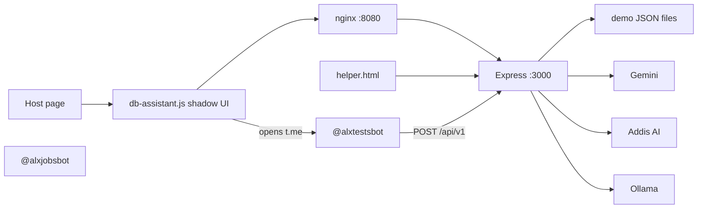

# Architecture

Plain map of this folder. The track README has the same picture, including both bots.

@alxjobsbot is not on this diagram's request path. It scrapes job boards and does not call the API.

## Processes

| Piece | Role |
| --- | --- |
| `module/db-assistant.js` | Custom element. Shadow CSS. Loads i18n and providers with `import()`. |
| `nginx.conf` | Serves `savanna/` as the site, `/module/`, and `/demo/`. Proxies API paths. No gzip. No CORS on the module. |
| `api/app.js` | Health, ask, content, speech, translate, tickets, webhooks, SMS, `/docs`, `/helper`. |
| `api/lib/retrieve.js` | Same 0.5 threshold as `providers/none.js`. At most two sections. |
| `module/providers/local.js` | Ollama `POST {base}/v1/chat/completions`, only after retrieval. |
| `api/public/helper.html` | Lists waiting tickets. Token is typed into the page, not stored by the widget. |
| `api/data/escalations.json` | Ticket file. Gitignored. |

## One question

1. The widget refuses advice phrases, or scores sections.
2. If health said a model is on, it POSTs `{ question, language, sections }` to `/api/v1/ask`.
3. The server scores again. No section at the threshold: `mode: "not-found"`, model not called.
4. A hit with the model off: excerpt, `mode: "offline"`.
5. A hit with Gemini or Ollama: only the picked sections are sent. Failure: excerpt, `mode: "offline-fallback"`.
6. The panel shows text and source links, or "I could not find this in the course."

## What is not connected

- No service worker.
- No WebRTC. Screen share is a local video.
- Webhooks are memory only, with no shared secret.
- `data-theme` is unused.
- `GET /module/calendar.js` exists so a page can load the date helper. It is not in `openapi.yaml`.
